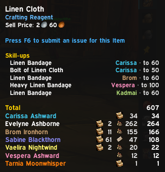
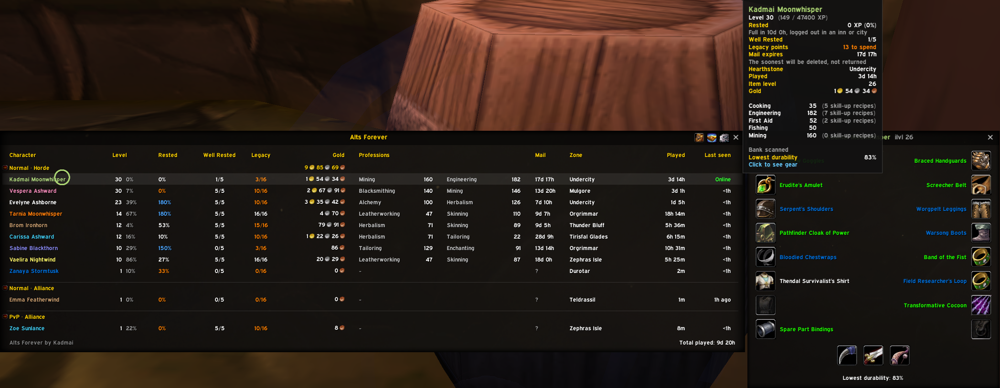
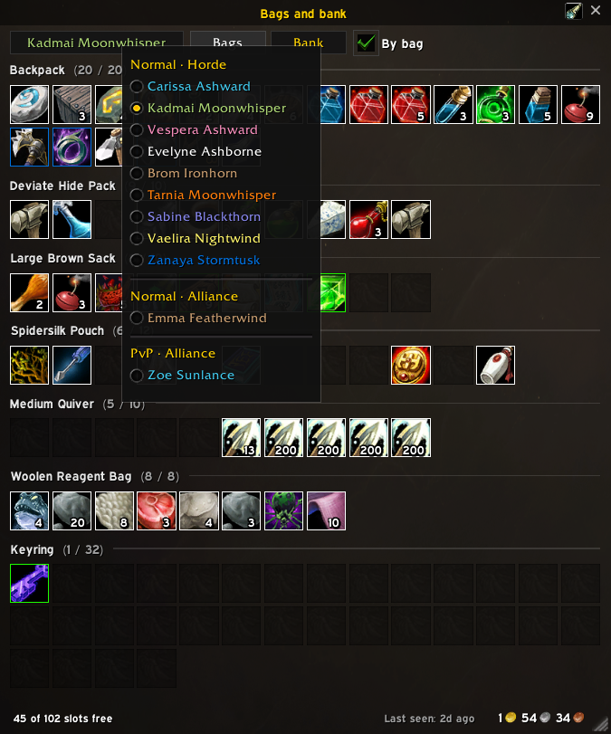
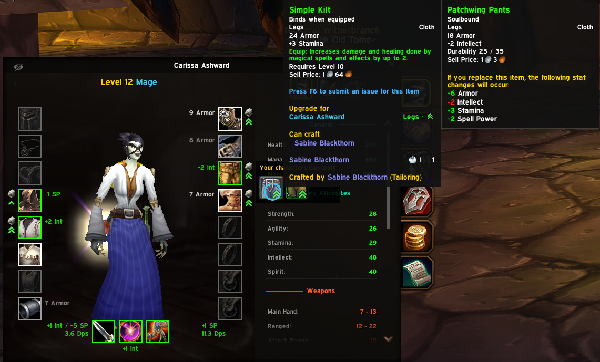
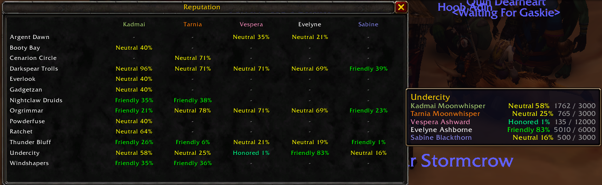
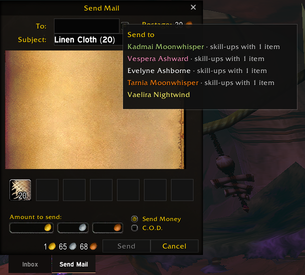
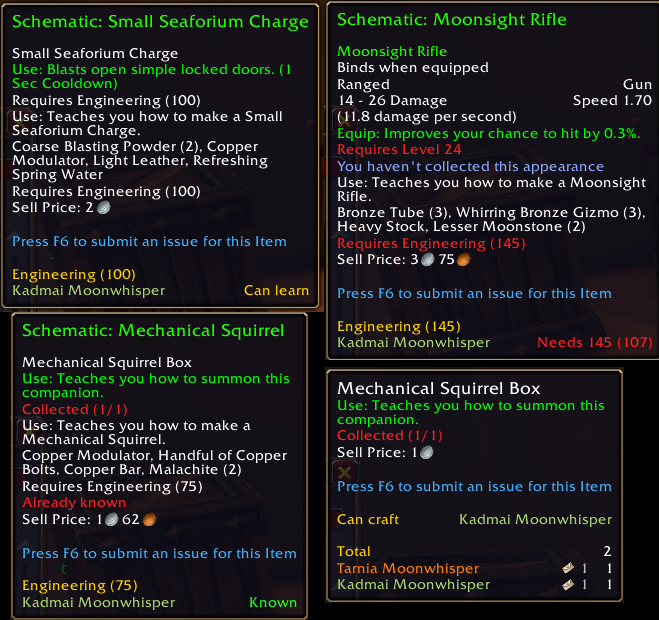
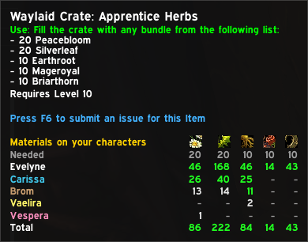

<p align="center"></p>

# Alts Forever

By **Kadmai**.

A World of Warcraft: Forever addon (interface 16001) that adds a total and a per-character breakdown of an item to its tooltip:



Locations are shown as icons: a linen bag (bags), banker (bank), mailbox (mail) and white shirt (wearing). You can pick your own icons, or words instead, with `/af icons`.

The current character always comes first. Other characters are sorted by count. Already have counts from a bag addon such as Baganator? Turn ours off with **Show item counts** in the options (or `/af counts`); everything else in the tooltip stays.

Hovering the money at the bottom of your bags lists each character's gold and the total, laid out the same way (also in ElvUI's bags, and in EllesmereUI's when its own gold tracking is turned off). Hovering the **experience bar** lists your other characters still levelling, with their level, XP and rested XP, and hovering the **reputation bar** lists their standing with the faction you're watching.

Type `/af` to open the **overview**: every character with level and XP, rested XP (including what they've built up since logging out), Legacy points left to spend and their Well Rested rank, gold, main professions, zone, time played and when you last played them, with total time played at the bottom. With characters on more than one ruleset or both factions, they're grouped under headings such as "Normal · Horde", each with its gold total; click a heading to collapse it. Hover a row for details such as rested XP until full, hearthstone location and item level. **Click a row** to see that character's gear, laid out like the character panel: hover any item for its tooltip, shift-click to link it in chat. Nearly broken items are tinted red and the lowest durability is shown.



**Bags and bank:** your own bags and bank (an entry in the bag's portrait menu, or a small Alts Forever button in the header of Blizzard's bank and of ElvUI's and EllesmereUI's bags and bank), the bag button in the overview's title bar (or `/af bags`, `/af bank`, or right-click a character) opens a window showing any character's bags or bank slot by slot, as you last saw them: each stack with its count, empty slots, how many slots are free, and a coloured border for uncommon and better items. Everything shows in one grid, or tick **By bag** for a section per bag or bank tab, e.g. "Red Linen Bag (7 / 8)". The character's gold is at the bottom. Drag the bottom-right corner to resize: the width sets the slots per row (10 to 30), the height how tall it gets before scrolling, and both are remembered. Pick the character from the dropdown and switch between Bags and Bank. Hover an item for its tooltip, shift-click to link it. A character's slots are recorded the next time you log in on them (bags) or visit their bank; until then the window shows one slot per item with its total.



**Search:** `/afs` (or `/af search` or `/af find`, the magnifier in the overview, Search... in the options menu, or a key you bind under Key Bindings > AddOns) opens a search box for every item your characters have **or can craft**. Each result shows how many you have, who has them and who can make it. Use the arrow keys and press Enter to open that character's bags or bank with the item lit up (yours first, else whoever has the most; click "Showing: ..." at the bottom of the window to see every slot again); Shift+Enter links it in chat. Start with `@owned` or `@craft` to see only one side, e.g. `@craft sword`. Characters on other rulesets and factions are left out unless you show them in tooltips. The bags window has a search button too, in its title bar.

**Mail expiry:** a few seconds after you log in, Alts Forever warns in chat if any character has mail with items or gold expiring within 3 days, and says whether it'll be returned to the sender or deleted. The overview's Mail column shows how long each character has; `/af mail` lists them all.

Hovering a recipe (pattern, schematic, formula...) lists your characters who have that profession: **Known**, **Can learn**, **Needs 120 (107)** (required skill, their skill), or **Not scanned**. Open each profession window once on each character so Alts Forever knows which recipes they've learned.

**Can craft:** hovering any item that one of your characters knows how to make adds a "Can craft" section listing them one per line (the current character first). This also comes from opening each profession window once.

**Upgrades:** hovering an item you could pass on (binds when equipped, not yet bound) lists which of your characters it would be an upgrade for, in which slot and how big an upgrade it is: one green chevron for minor, two stacked for decent, three for major, judged against everything that character wears (so +1 Agility over a plain cloak is minor, a much better weapon major); characters up to 5 levels short are shown in grey with the level they can wear it at. Hovering a recipe, or a recipe in a profession trainer's list, does the same for the item it makes. On your character sheet, a small anvil beside a slot means you or an alt can craft an upgrade for it that you can wear now and that binds when equipped (armour only of the heaviest type you wear); it carries the best one's chevrons; hover it for the best few, click it to see them all. Turn the anvils off with **Show craftable upgrades on the character sheet** in the options, or `/af anvils`. Items bound to you show only your own row. Each character is judged by the stats their role values, from the talent tab they've put most points in; right-click a character in the overview (Upgrade role) or use `/af role` to choose it yourself. Alts Forever knows each character's gear from the last time you logged in on them.



**Legacy points:** Legacy points are earned by your account but spent by each character separately, so Alts Forever keeps track of who still has points to spend. Logging in on a character with points to spend says so in chat, and earning a point tells you how many of your characters can spend it. The overview shows each character's points to spend and Well Rested rank, and the rested XP estimate counts each character's own ranks. `/af legacy` lists them all.

**Reputation:** the reputation button in the overview's title bar opens a panel with every faction down the side and your characters across, e.g. "Honored 27%"; hover a faction for exact numbers.



**EllesmereUI and ElvUI:** if you use EllesmereUI, Alts Forever's windows take on your EllesmereUI look (theme, accent colour and font) automatically, and character names use your EllesmereUI class colours. EllesmereUI can turn this off per addon in its options. With ElvUI, the windows get ElvUI's style and font instead. Custom class colours from ElvUI or addons like !ClassColors are used too. Everyone else gets the classic Warcraft look.

**Send to alt:** at the mailbox, a small arrow next to the To box lists your characters (same faction); picking one fills in their name. Characters who can still skill up with what you've attached are marked and listed first. Turn it off with "Send mail to alts" in the options menu.



**Skill-ups across your alts:** "Can craft" marks characters who'd still get a skill-up from making the item ("Tarnia Moonwhisper · skill-ups to 115"), and hovering a material lists the recipes your characters can still skill up with it, under "Skill-ups" ("Heavy Linen Bandage   Tarnia · to 115"): you first, then your other characters, 2 recipes each with the most skill-ups left, up to 6 lines. The overview's row tooltip counts each profession's recipes that still give skill-ups, or says "train to skill up" for a character at their rank's maximum (e.g. 75/75), who is left out of the skill-up lines until they train. It all comes from the game when a profession window is opened; `/af skillups` turns it off.



**Waylaid Crates:** hovering a crate adds a grid of the materials it takes: a column per material (its icon, in the crate's order), how many are needed, a row for each of your characters who has any (you first, then whoever has most; up to 10) and the total. A character's count is green when they have enough to fill it alone, and the total is green when your characters have enough between them.



## Playing with a controller

Item tooltips (counts, Can craft, skill-ups) work with any input. With Forever's Gamepad UI on (Options > Gameplay > Gamepad), Alts Forever's windows join it like the game's own: focus jumps into a window when it opens, the D-pad moves between its buttons and shows their tooltips, A presses, B closes, and LT/RT switch between open windows.

- **Opening it:** put a macro with `/af` (overview) or `/af bags` (bags and bank) on a gamepad action bar, or bind "Open overview" and "Bags and bank" under Key Bindings > AddOns > Alts Forever. The Alts Forever entry in your bag's menu and the button on the bank work with the controller too.
- **A on a character** in the overview opens their menu: Gear, Bags, Bank and Forget (with a mouse, click for gear and right-click for the menu, as before).
- **Long lists** (reputation, the icon picker) have page buttons; in the bags window, moving onto a slot scrolls it into view.
- Resizing the bags window and moving windows still need a mouse.

Forever's controller support is in alpha and changes with each beta build, so please report anything that doesn't work.

## Languages

English, German, French, Spanish (Spain and Latin America), Brazilian Portuguese, and Simplified and Traditional Chinese, following your game's language. The translations are new: if something reads oddly in your language, please say so in the comments on CurseForge.

## Status

Bags (including the keyring and reagent bag), bank tabs, mail (including items you mail to your alts), equipped items and equipped bags.
The bank and inbox are read when you open them; until then that character shows no bank or mail counts.

## Install

Install it from CurseForge, or link or copy this folder to `<WoW Forever>\Interface\AddOns\AltsForever`. The folder in `AddOns` must be named `AltsForever`.

## Rulesets and factions

Each ruleset (Normal, PvP, Roleplaying, Hardcore) has its own auction house and mail, and mail never crosses factions, so characters on another ruleset or the other faction can't trade with yours. Alts Forever notes each character's ruleset when you log in on them:

- The overview groups your characters by ruleset and faction (e.g. "Normal · Horde"), each with its own gold total. Click a group's heading to collapse it; it stays collapsed until you click it again.
- Item and gold tooltips, Can craft, skill-ups, upgrades and the XP and reputation bars list only characters you can mail. Turn on **Show other rulesets and factions** (or `/af rulesets`) to see the others too, in grey (they can't trade with you) under their own heading and total.
- Send to alt and Waylaid Crates only ever count characters you can mail.

Characters you haven't logged in on since updating count as being on yours until you do.

## Settings

Options > AddOns > Alts Forever has every setting, with a short explanation of each: what tooltips show and their icons on the left, the extras, minimap button and window size on the right. The minimap button's right-click menu and the cog in the overview keep to what you switch while playing (Open overview, Bags and bank, Show other rulesets and factions) and Settings... for the rest, and every setting has a slash command. **Window size** makes Alts Forever's windows bigger or smaller (50% to 300%), on top of the game's UI scale: handy if you play at a small UI scale. With EllesmereUI, it follows EllesmereUI's Window Scale until you choose a size of your own (`/af scale eui` to follow it again).

## Commands

Everything below can also be done by clicking: **click the Alts Forever minimap button** (or Alts Forever in the minimap's addon menu) to open the overview, **right-click it** (or the cog in the overview) for options. Drag the button to move it around the minimap, or hide it from the options menu. With a data broker display such as Bazooka, Titan Panel or ChocolateBar, Alts Forever is there too (click and right-click work the same), so you can hide the minimap button and keep it there. And **right-click a character in the overview** to see their gear, bags or bank, choose their upgrade role, or forget them.

| Command | What it does |
|---|---|
| `/af` | Open or close the overview window |
| `/af rep` | Open or close the Reputation panel |
| `/af icons` | Choose the icons item tooltips use for bags, bank, mail and worn items |
| `/af bags [name]`, `/af bank [name]` | Show your bags or bank slot by slot, or another character's, e.g. `/af bank Tarnia` |
| `/afs [text]`, `/af search [text]` or `/af find [text]` | Search every item your characters have or can craft; Enter opens their bags with it lit up |
| `/af mail` | List every character's soonest mail expiry |
| `/af list` | List stored characters |
| `/af skillups` | Turn the skill-up details in tooltips on or off |
| `/af upgrades` | Turn upgrades in item tooltips on or off |
| `/af anvils` | Show or hide the anvils on your character sheet that mark craftable upgrades |
| `/af counts` | Turn the item counts in tooltips on or off, e.g. if Baganator or Bagnon already shows them (Can craft, skill-ups, upgrades and crates stay) |
| `/af rulesets` | Show or hide your characters on other rulesets (Normal, PvP...) or the other faction in tooltips; hidden by default |
| `/af legacy` | List each character's Legacy points to spend and Well Rested rank; `/af legacy on` or `off` turns the chat reminders on or off |
| `/af role Full Name role` | Choose what a character's upgrades are judged by: `melee`, `ranged`, `caster`, `healer`, `tank` or `feral` (whichever their class has), or `auto` to follow their talents |
| `/af sendmail` | Turn the send-to-alt arrow at the mailbox on or off |
| `/af scale 150` | Make Alts Forever's windows 150% of their size (any size from 50 to 300); on its own, shows the size; `/af scale eui` follows EllesmereUI's Window Scale |
| `/af minimap` | Show or hide the minimap button (the data broker launcher stays) |
| `/af stats` | Turn session stats on or off (off by default): XP this session and time to level on the XP bar, gold this session, today and this week on your bag gold |
| `/af delete Full Name` | Forget a character, e.g. `/af delete Thessa Oakenbrook` |
| `/af mem` | Show the addon's memory use |

`/altsforever` also works.

## Tests

The tests run the addon outside the game against a small fake of the WoW API (`tests/wow.lua`). They need Lua 5.1 (the version WoW uses):

```
luajit tests/run.lua
```

## Design notes

- Item counts are stored as `itemID -> count` per location per character, without item links. For the bags window, each bag's and bank tab's slots are kept too, one number per slot (item and stack size), about 1.5 KB per character. The rest is small: each equipped item's link (for the gear panel), learned recipe names with what they make, their grey point and reagents (one short string per recipe your characters know), and a few numbers such as level, gold and time played. Five characters take about 25 KB on disk.
- Scans only happen on events. `BAG_UPDATE_DELAYED` groups a batch of changes into one scan, and only when a carried bag changed. There are no OnUpdate handlers.
- Scans refill the existing tables and read stacks through one reused `ItemLocation`, so a scan allocates nothing.
- Other characters' tooltip lines are built once per item and cached, up to 500 items, and so is their column layout. The current character's line is recomputed only when their data changes. Hovering an item again creates no garbage.
- The overview, gear and bags windows aren't created until you first open them.
- Measured outside the game (`luajit tests/perf.lua`): about 220 KB for the addon, nearly all of it the addon's own code, plus about 9 KB per character. The icon picker's lists of every game icon are loaded only while the picker is open. Nothing grows while you play. `/af mem` shows the real figure in game.

## Development

Run the tests with `luajit tests/run.lua` and the memory and garbage measurements with `luajit tests/perf.lua [saved file]` from the project root (LuaJIT is Lua 5.1, the same as WoW). `tests/wow.lua` fakes just enough of the WoW API to load the addon outside the game. Run `tools/fetch-reference.ps1` to download the API references into `reference/`.
